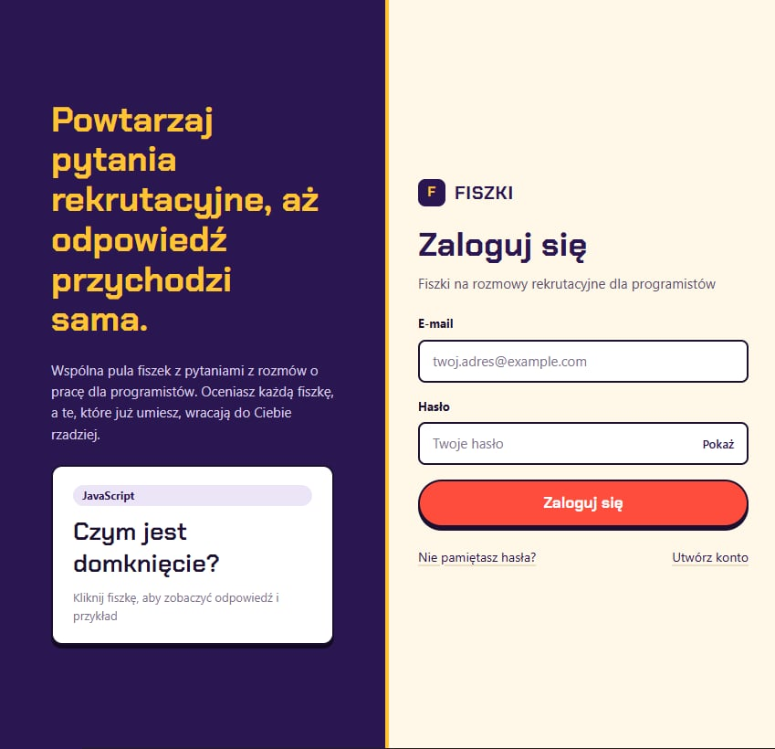
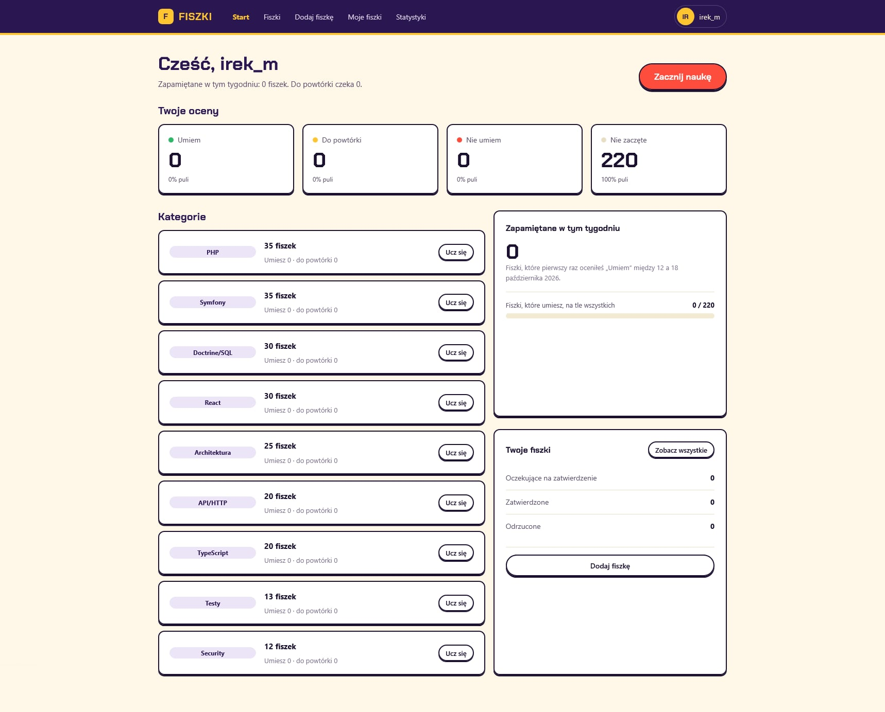
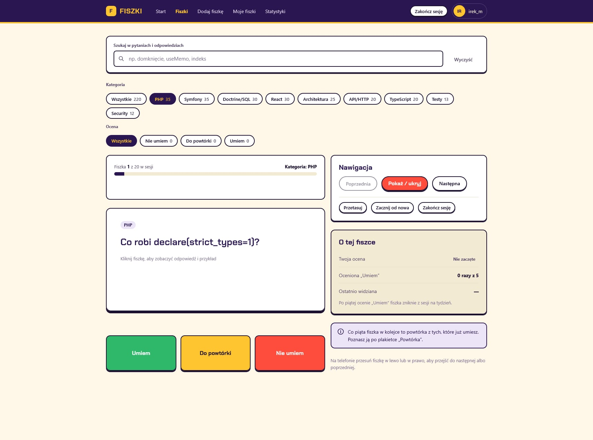
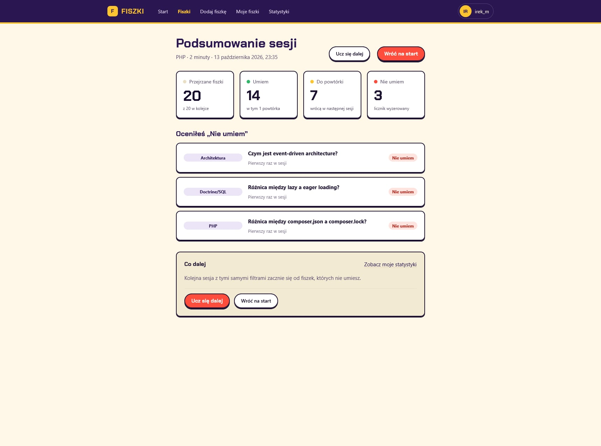
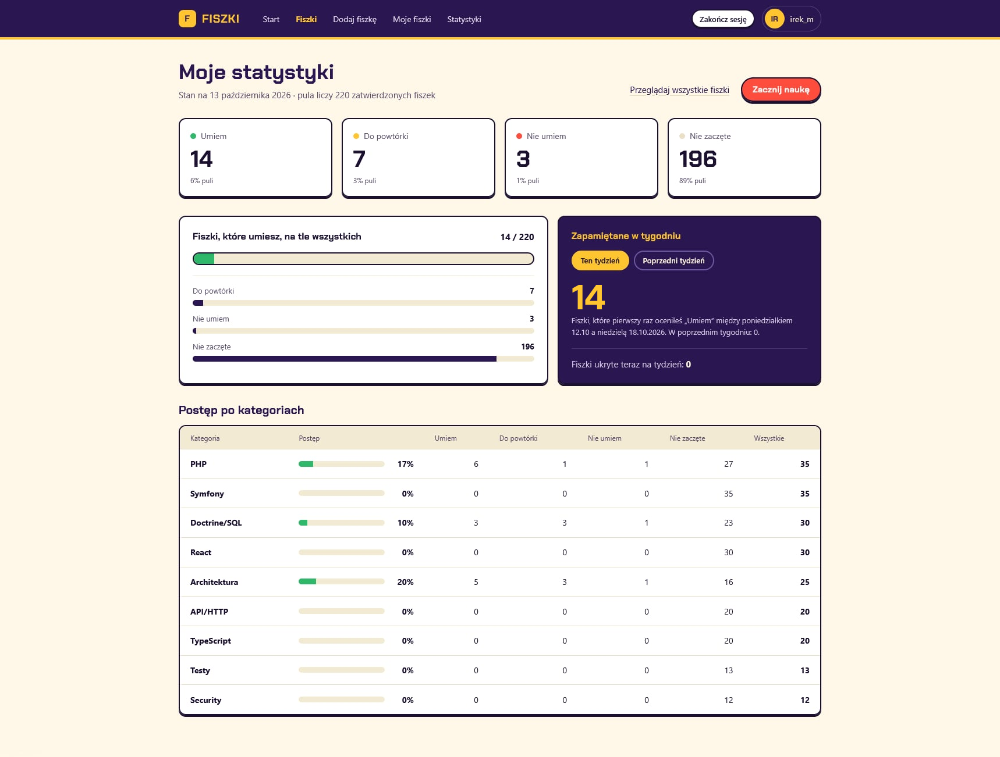
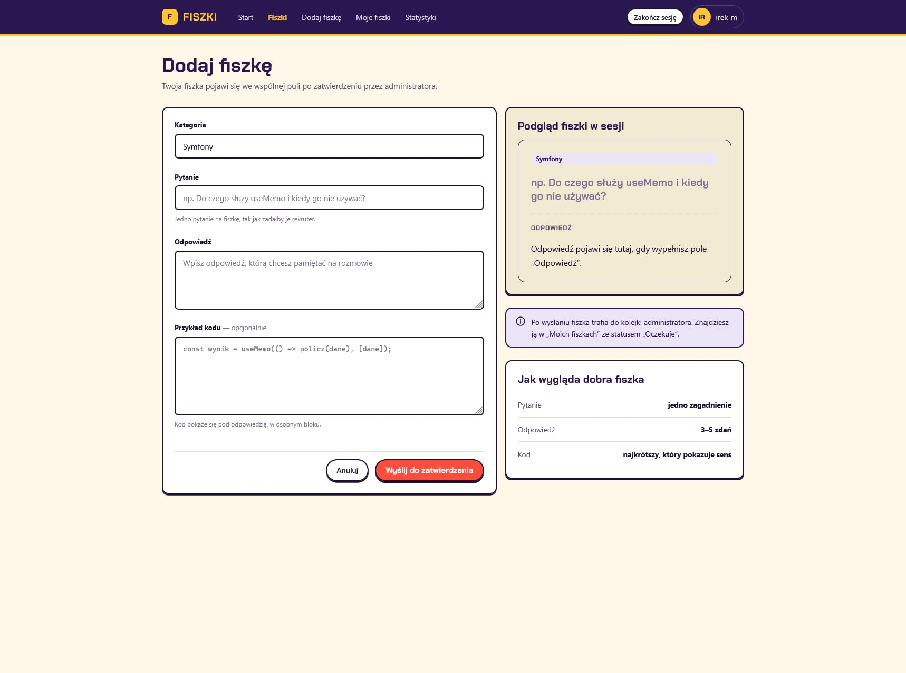

# Fiszki

**Flashcards for developer-interview preparation.** A full-stack web application where learners
work through a shared pool of interview questions, reveal the answer with a code example and rate
how well they know it. Anyone signed in can submit a new card; it joins the pool only after an
administrator approves it.

> The interface is in Polish. Code, comments, commit messages and documentation are in English.


---

## Screenshots

| Login | Home |
|---|---|
|  |  |

| Study session | Session summary |
|---|---|
|  |  |

| Personal statistics | Submit a flashcard |
|---|---|
|  |  |

---

## Features

**Learning**
- Study sessions with a flip card: question → answer with a code example.
- Three ratings: **Umiem** (I know it), **Do powtórki** (review), **Nie umiem** (I don't know it).
- Spaced reinforcement: known cards are mixed back among unknown ones, and a card confirmed as known
  several times is hidden from sessions for a week.
- Session summary and personal statistics, including cards memorised this week.
- Library of all cards with search, category and rating filters.

**Community and moderation**
- Submit your own flashcards; track their status (Pending / Approved / Rejected) and edit them.
- Administrator approval queue with a rejection reason and a recorded moderation decision.
- Administrator panels: overview, all cards, users and roles, categories.

**Accounts**
- Registration, login, password reset by e-mail, profile, password change, account deletion.
- Three roles: Guest, User, Administrator.

The app ships with **220 approved flashcards in nine categories** (PHP, Symfony, Doctrine/SQL,
API/HTTP, Security, Testy, React, TypeScript, Architektura).

---

## Tech stack

| Area | Choice |
|---|---|
| Framework | Next.js 15 (App Router), React 19, server components and server actions |
| Language | TypeScript in strict mode, no `any` |
| Database | PostgreSQL through Prisma (with the `pg` driver adapter) |
| Auth | Auth.js v5, credentials provider, passwords hashed with argon2 |
| E-mail | Nodemailer over SMTP, used only for password reset |
| Styling | Tailwind CSS v4, design tokens ported from HTML mockups, no UI library |
| Validation | Zod at every input boundary |
| Tests | Vitest (unit and integration), Playwright (end-to-end) |

---

## Engineering highlights

- **Pure domain layer.** All study rules (marking counter, weekly hide, reinforcement, weekly
  statistics) are plain functions in `src/domain/`, free of Prisma and React, and unit-tested
  against their boundaries.
- **One use case per service.** `src/server/services/` holds a single-purpose file per operation;
  server actions validate with Zod, call one service and return.
- **Server-side authorization.** Every protected page, action and route re-checks the session and
  role on the server. A missing permission and a missing resource look the same to the client.
- **Secure password reset.** Tokens are hashed at rest, single use and short-lived; the response is
  identical whether or not the address exists.
- **Design-system discipline.** Every repeating element (button, badge, tile, chip, modal, …) is a
  component in `src/components/ui/`; no raw colour values in JSX.
- **Small files.** No source file exceeds 100 lines; splitting is by responsibility.
- **Tests named after the specification**, e.g. `SCR-06` (screen) or `DEC-03` (decision), so each
  one traces back to a requirement.
- **Isolated test databases.** Integration and end-to-end tests run against throwaway PostgreSQL
  instances, so no local database setup is needed to run them.

---

## Getting started

Requirements: Node.js 20+ and a PostgreSQL database.

```bash
npm install
cp .env.example .env      # fill in the values; .env is never committed
npx prisma migrate dev    # create the schema
npx prisma db seed        # categories, 220 flashcards, one administrator
npm run dev               # http://localhost:3000
```

Environment variables (names only, see `.env.example`):

| Variable | Purpose |
|---|---|
| `DATABASE_URL` | PostgreSQL connection string |
| `AUTH_SECRET`, `AUTH_URL` | Auth.js secret and base URL |
| `SMTP_HOST`, `SMTP_PORT`, `SMTP_USER`, `SMTP_PASSWORD`, `SMTP_FROM` | Password-reset e-mail |
| `SEED_ADMIN_EMAIL`, `SEED_ADMIN_PASSWORD` | Administrator account created by the seed |

The seed is idempotent and refuses to run without the administrator variables.

---

## Scripts

| Command | What it does |
|---|---|
| `npm run dev` | Development server |
| `npm run build` / `npm run start` | Production build / run it |
| `npm run lint` | ESLint |
| `npm run typecheck` | TypeScript check |
| `npm run test` | Unit and integration tests (Vitest) |
| `npm run test:e2e` | End-to-end tests (Playwright) |

---

## Project structure

```
src/
  app/            routes: (auth), (app), (admin)/administracja, not-found
  domain/         pure study and progress rules
  server/         db, auth, permissions, mail, services, actions
  components/     ui kit and per-screen parts
prisma/           schema, migrations, seed and the 220 cards
tests/
  unit/           domain rules and helpers
  integration/    services and access control against a real database
  e2e/            browser flows
```

### Data model

`User` · `Category` · `Flashcard` · `ModerationDecision` · `CardProgress` · `ReviewEvent` ·
`StudySession` · `PasswordResetToken`

---

## Testing

- **Unit:** every exported domain function, including boundaries such as the fourth versus the
  fifth marking, or the last day versus the first day after a hide.
- **Integration:** every access-controlled action as Guest, User and Administrator, asserting the
  refusal as well as the success, plus the Pending → Approved / Rejected transitions.
- **End-to-end:** registration → login → start; study session → summary; submit a card →
  administrator approves → it appears in the library.

---

## About

Built as a portfolio project to demonstrate a complete, production-style full-stack application:
authentication, role-based authorization, a moderated content workflow, domain-driven business
rules, a pixel-faithful UI built from mockups, and a layered test suite.
